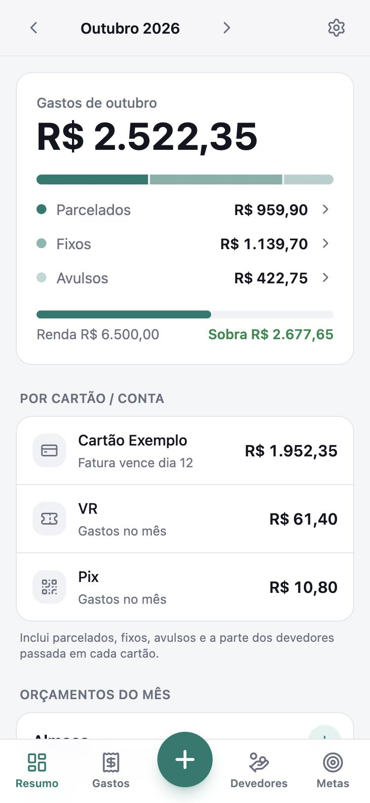
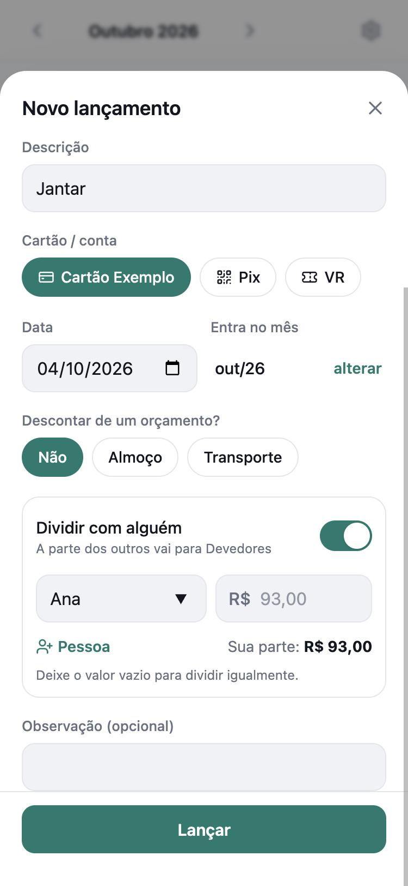
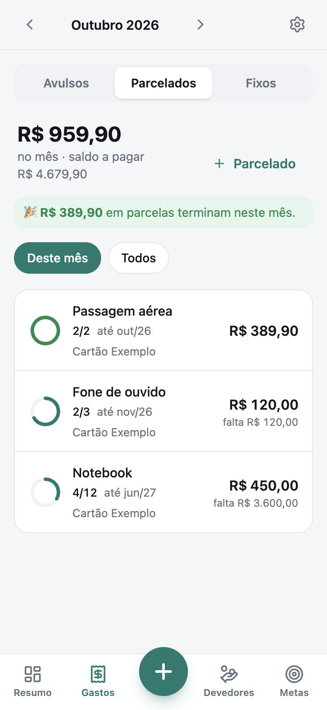
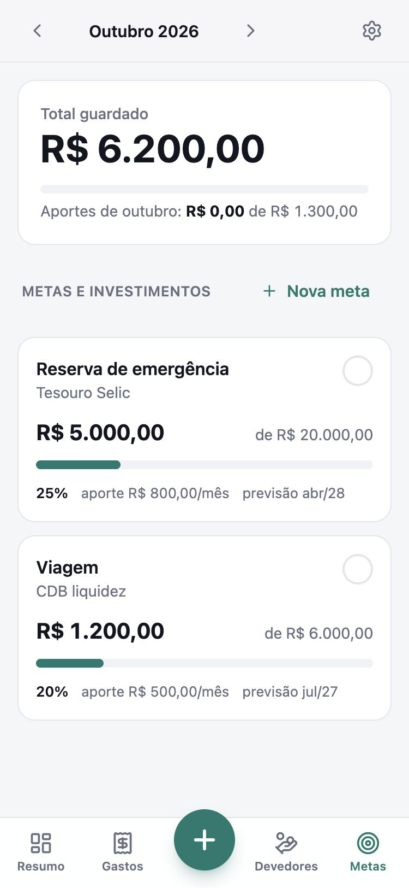
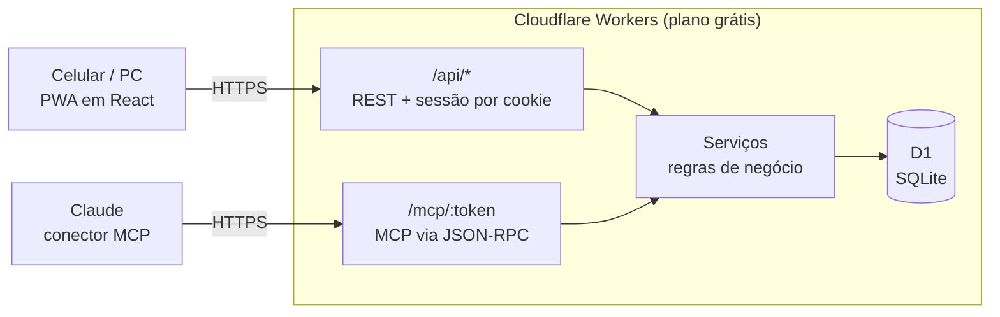

# Finanças pessoais com MCP

App de finanças pessoais para controlar o mês **pelo celular, pelo computador ou conversando com o Claude**.

Ele nasceu para substituir uma planilha de controle mensal, com abas para compras parceladas, gastos fixos, lançamentos do mês, quem me deve e o que descontar dos valores reservados. A ideia era manter a mesma lógica, mas com três vantagens sobre a planilha:

- **Lançar um gasto em segundos no celular**, como um app instalado (PWA).
- **Lançar conversando:** um servidor [MCP](https://modelcontextprotocol.io) conecta o app ao Claude, então dá para dizer *"lança 32,50 de almoço no VR"* ou *"gastei 186 no jantar no cartão, metade é da Ana"*.
- **Custo zero:** roda inteiro no plano gratuito da Cloudflare (Workers + banco D1). Não precisa de servidor, domínio, banco pago nem computador ligado.

<p align="center">
  
  
  
  
</p>

<p align="center"><sub>Capturas com dados fictícios.</sub></p>

## Funcionalidades

| Tela | O que faz |
|---|---|
| **Resumo** | Total de gastos do mês (parcelados + fixos + avulsos), quanto cai em cada cartão, andamento dos orçamentos, quem te deve, aportes do mês, entradas do mês e o **saldo** (inicial + sobra do mês = final) |
| **Gastos → Avulsos** | Lançamentos do mês agrupados por dia, com filtro por cartão ou orçamento |
| **Gastos → Parcelados** | Parcela atual (ex.: 4/12), mês da última parcela, quanto falta pagar e o que termina neste mês |
| **Gastos → Fixos** | Assinaturas e contas: marcar como pago, ajustar o valor só de um mês (ex.: conta de luz), encerrar. E os **orçamentos** |
| **Devedores** | Quem te deve, agrupado por pessoa, com “Recebi tudo”. Aceita **devedor parcelado**: as próximas parcelas ficam separadas até vencerem |
| **Metas** | Saldo investido, valor da meta, aporte mensal com check, previsão de quando atinge e quanto guardar por mês para cumprir o prazo |
| **Entradas** | Dinheiro além do salário fixo (13º, bônus, PLR, freela…), somado à renda do mês em que entra |
| **Ajustes** | Cartões (dia de fechamento, vencimento e em que você paga), salário líquido fixo, link do conector do Claude e backup em JSON |

### Como as regras funcionam

- **Mês = quando o dinheiro sai da conta.** Com o dia de fechamento cadastrado, uma compra feita no dia do fechamento ou depois vai sozinha para a fatura seguinte. A fatura conta no mês em que vence. Se você informar o **dia em que paga** (ex.: vence dia 1 e você paga dia 25, quando recebe o salário), ela conta no mês em que você paga. Assim o salário de outubro, a fatura paga em outubro e as contas de outubro aparecem juntos.
- **Orçamentos** (os “fixos a descontar”): você reserva um valor por mês, por exemplo R$ 600 de almoço, e lança os gastos dentro dele. O app mostra quanto falta. Esses gastos não somam de novo no total do mês; só entra o que passar do valor reservado.
- **Dividir com alguém:** ao lançar um gasto, sua parte fica nos seus gastos e a parte de cada pessoa vira um **devedor**, no mesmo cartão. Assim a fatura bate com o valor cobrado e você sabe quanto vai receber.
- **Devedor parcelado:** quando você passa no seu cartão uma compra parcelada de outra pessoa, cada parcela vira um devedor no mês da fatura dela. Ela só passa a contar como pendente quando o mês chega, e entra na fatura daquele mês. “Recebi tudo” marca só o que já venceu.
- **Renda do mês:** salário fixo (em Ajustes) + entradas extras do mês. A sobra do mês é renda − gastos − aportes planejados.
- **Saldo acumulado:** o saldo final de um mês (saldo inicial + sobra) vira o saldo inicial do seguinte, também nos meses futuros, como previsão. Se o valor real for outro (você conferiu o banco), ajuste o saldo inicial do mês em **Resumo → Saldo → Ajustar**: os meses seguintes passam a partir dele, e dá para voltar ao automático. O acúmulo começa no mês em que o recurso foi instalado, com saldo 0, para não somar meses antigos com dados incompletos.
- **Metas:** cada meta é uma “caixinha” com saldo. Aportes, resgates e atualizações de saldo (rendimentos) ficam no histórico. O check do mês lança o aporte planejado.

## Conversando com o Claude (MCP)

O mesmo Worker que serve o app expõe um servidor MCP. Depois de adicioná-lo como conector no Claude (web, desktop ou celular), dá para usar linguagem natural:

- “Lança 32,50 de almoço no VR”: desconta do orçamento de almoço.
- “Gastei 186 no jantar no cartão, metade é da Ana”: sua parte vira gasto e a da Ana vira devedor.
- “Comprei um notebook de 5.400 em 12x”
- “A conta de luz desse mês veio 212,37”
- “Cancela o streaming a partir de dezembro”
- “Passei um celular de 2.400 em 12x no cartão pro Pedro”: registra as 12 parcelas como devedor.
- “O Pedro me pagou tudo”: marca o que já venceu; as parcelas futuras continuam pendentes.
- “Recebi 3.100 de 13º”: soma na renda do mês.
- “Terminei outubro com 480 na conta”: ajusta o saldo, e novembro começa com R$ 480.
- “Faz o aporte do mês na reserva de emergência”
- “Como estou esse mês?” / “Quanto falta do orçamento de transporte?”

| Ferramenta | Para quê |
|---|---|
| `resumo_mes` | Resumo do mês: totais, faturas, orçamentos, devedores, aportes |
| `listar_cadastros` | Cartões, orçamentos, fixos, metas e pessoas (para o Claude achar os nomes certos) |
| `lancar_despesa` | Gasto avulso, com orçamento e divisão entre pessoas opcionais |
| `lancar_parcelado` | Compra parcelada (nova ou já em andamento) |
| `adicionar_fixo` / `ajustar_fixo` | Cadastrar, ajustar no mês, marcar como pago ou encerrar fixos e orçamentos |
| `registrar_devedor` / `marcar_recebido` / `listar_devedores` | Quem te deve (à vista ou parcelado) |
| `registrar_entrada` | Entrada extra no mês: 13º, bônus, PLR, freela |
| `ajustar_saldo` | Corrige o saldo acumulado com o valor real (no início ou no fim de um mês) |
| `listar_lancamentos` / `editar_lancamento` / `remover_lancamento` | Consultar e corrigir lançamentos |
| `criar_meta` / `registrar_aporte` / `atualizar_saldo_meta` / `listar_metas` | Metas e investimentos |
| `cadastrar_conta` | Cadastrar cartões e formas de pagamento |

As ferramentas e seus parâmetros estão em português de propósito: é o que o Claude usa para casar com o que você fala.

## Arquitetura



- **Um único Worker** serve o app (arquivos estáticos), a API REST usada pela interface e o servidor MCP. API e MCP chamam a **mesma camada de serviços**, então as regras valem igual nos dois caminhos.
- **MCP sem SDK:** o protocolo (transporte Streamable HTTP, sem sessão, respostas JSON) foi implementado direto sobre JSON-RPC. Assim cada chamada fica leve o suficiente para o limite de CPU do plano gratuito do Workers.
- **Dinheiro em centavos** (inteiros) em todo o banco, para não haver erro de arredondamento.
- **Datas no fuso de São Paulo**, para o "hoje" não virar o dia seguinte depois das 21h.

**Stack:** TypeScript · React 19 · Tailwind CSS 4 · Vite · Hono · Zod · Cloudflare Workers + D1.

## Rodar localmente

```bash
git clone https://github.com/JoaoClemer/lifeos.git
cd lifeos
npm install
cp .dev.vars.example .dev.vars   # defina APP_PASSWORD e MCP_TOKEN locais
npm run db:migrate:local
npm run db:seed:local            # opcional: dados fictícios de exemplo
npm run dev                      # http://localhost:5173
```

Para abrir no celular na mesma rede Wi-Fi: `http://<ip-do-computador>:5173`.

## Testes

```bash
npm test
```

Os testes rodam dentro do runtime do Workers, com um D1 local criado a partir das migrations. Eles fixam as regras do financeiro (resumo, faturas, orçamentos, saldo acumulado, devedores, metas, backup e as ferramentas do MCP) com dados fictícios em [test/fixtures/finance.ts](test/fixtures/finance.ts). Se um teste de snapshot falhar, a mudança alterou um resultado: confira se era a intenção antes de atualizar o snapshot (`npx vitest run -u`).

Antes de publicar uma mudança grande, dá para comparar as respostas da API e do MCP com uma cópia dos dados reais. Carregue o backup da produção no banco local, rode `npm run dev` e:

```bash
npm run snapshot -- antes     # com o código que está no ar
npm run snapshot -- depois    # com o código novo
diff -r backups/snapshots/antes backups/snapshots/depois
```

Os arquivos ficam em `backups/`, fora do git, porque contêm dados pessoais.

## Publicar na Cloudflare (grátis)

1. Crie uma conta grátis em <https://dash.cloudflare.com/sign-up> e faça login no terminal:
   ```bash
   npx wrangler login
   ```
2. Crie o banco e coloque o `database_id` retornado no `wrangler.jsonc`, substituindo o que está lá:
   ```bash
   npx wrangler d1 create financas
   ```
3. Crie as tabelas:
   ```bash
   npm run db:migrate:remote
   ```
4. Publique:
   ```bash
   npm run deploy
   ```
   Na primeira vez, o Wrangler pede um subdomínio `workers.dev` para a sua conta. O endereço final fica `https://financas.<seu-subdominio>.workers.dev`.
5. Defina os segredos. O terminal pede cada valor; nada fica no código:
   ```bash
   npx wrangler secret put APP_PASSWORD   # senha para entrar no app
   openssl rand -hex 32                   # gera um token aleatório: copie o resultado
   npx wrangler secret put MCP_TOKEN      # cole o token gerado
   ```

Para atualizar depois, rode `npm run deploy`. Se houver migrações novas em `migrations/`, rode `npm run db:migrate:remote` **antes** do deploy. As migrações são só aditivas, então a versão que está no ar continua funcionando enquanto isso.

**Instalar no celular:** abra o endereço no Safari (iPhone) ou no Chrome (Android) e toque em **Compartilhar → Adicionar à Tela de Início**.

## Conectar ao Claude

O link do conector aparece em **Ajustes → Conectar ao Claude** (botão copiar), no formato `https://financas.<seu-subdominio>.workers.dev/mcp/<MCP_TOKEN>`.

- **Claude (web, desktop e celular):** Configurações → Conectores → **Adicionar conector personalizado** → cole o link. Conectores adicionados na web também aparecem no app do celular.
- **Claude Code:**
  ```bash
  claude mcp add --transport http financas https://financas.<seu-subdominio>.workers.dev/mcp --header "Authorization: Bearer <MCP_TOKEN>"
  ```

## Segurança e privacidade

- **App:** login com uma senha única (`APP_PASSWORD`). A sessão fica num cookie `HttpOnly` assinado com HMAC e dura 180 dias.
- **MCP:** acesso protegido por um token separado (`MCP_TOKEN`), que vai na URL do conector ou no header `Authorization: Bearer`. O link funciona como uma senha: se vazar, troque com `npx wrangler secret put MCP_TOKEN` e atualize o conector.
- **Nada pessoal no repositório:** os segredos ficam em `.dev.vars` (local) e `wrangler secret` (produção), ambos fora do git. Dados reais também ficam fora: o `.gitignore` ignora qualquer `*.local.sql`.
- **Backup:** em **Ajustes → Baixar backup (JSON)** você exporta todos os dados.

### Importar seus dados

Para trazer dados que você já tem (por exemplo, de uma planilha), escreva os `INSERT`s em `seed/<nome>.local.sql` seguindo o formato de [seed/example.sql](seed/example.sql) e rode:

```bash
npx wrangler d1 execute DB --local --file=seed/<nome>.local.sql    # banco local
npx wrangler d1 execute DB --remote --file=seed/<nome>.local.sql   # produção
```

## Limites do plano gratuito

100 mil requisições por dia no Workers e 5 GB no D1, muito acima do uso pessoal.

## Estrutura do projeto

```
migrations/          schema do banco (D1/SQLite)
seed/example.sql     dados fictícios para desenvolvimento
src/shared/          tipos e utilitários (meses, datas e fusos, dinheiro) usados no front e no Worker
src/worker/          Worker: API REST (Hono), autenticação, serviços e servidor MCP
  services/          regras de negócio (contas, gastos, parcelados, fixos, devedores, entradas, metas, saldo, resumo)
  mcp/               protocolo MCP e definição das ferramentas
src/client/          app React (PWA)
  views/             telas (resumo, gastos, devedores, metas, ajustes)
  forms/             formulários de lançamento e edição
public/              ícones, manifest e service worker
test/                testes (Vitest no runtime do Workers) e dados fictícios de teste
scripts/snapshot.mjs retrato da API e do MCP para comparar antes/depois de publicar
docs/lifeos-plan.md  plano de evolução para o LifeOS (agenda, tarefas, treinos)
docs/screenshots/    capturas usadas neste README
```
