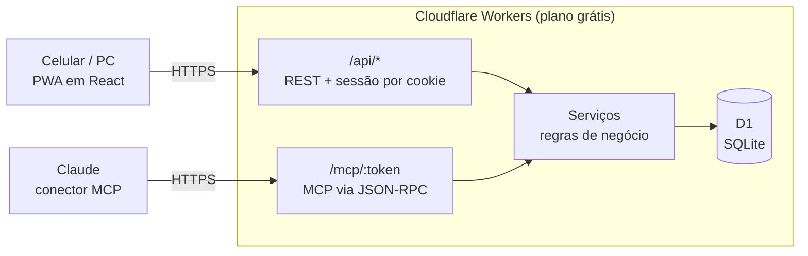

# LifeOS

Sistema pessoal para planejar, executar e acompanhar o dia a dia: **agenda, tarefas, treinos e finanças** num só lugar, **pelo celular, pelo computador ou conversando com o Claude**.

A ideia é abrir o app e responder rápido a quatro perguntas: o que tenho para fazer, o que planejei para hoje, o que consegui executar e como estão minhas finanças.

- **Hoje:** compromissos, tarefas atrasadas e do dia, treino planejado e o resumo financeiro do mês numa tela só.
- **Registrar em segundos no celular**, como um app instalado (PWA).
- **Conversando:** um servidor [MCP](https://modelcontextprotocol.io) conecta o app ao Claude. Dá para dizer *"marca dentista quinta às 14h"*, *"corri 8 km em 50 minutos"*, *"terminei o relatório"* ou *"lança 32,50 de almoço no VR"*.
- **Custo zero:** roda inteiro no plano gratuito da Cloudflare (Workers + banco D1). Não precisa de servidor, domínio, banco pago nem computador ligado.

O módulo de finanças nasceu para substituir uma planilha de controle mensal. Agenda, tarefas e treinos vieram depois, seguindo o [plano do LifeOS](docs/lifeos-plan.md).

<p align="center">
  
  
  
  
</p>

<p align="center"><sub>Capturas com dados fictícios.</sub></p>

## Funcionalidades

### Dia a dia

| Tela | O que faz |
|---|---|
| **Hoje** | Tela inicial: atalhos (tarefa, evento, treino, gasto), compromissos e horários reservados do dia, tarefas atrasadas, de hoje e prioritárias, treino do dia, finanças do mês e um resumo da semana |
| **Agenda** | Visões de dia, semana e mês. Eventos com horário ou de dia inteiro, local, link da reunião, categoria, cor e repetição (diária, semanal em dias escolhidos, mensal, anual; até uma data ou por número de vezes). Em evento repetido, a alteração vale para só esta, esta e as próximas, ou todas as ocorrências |
| **Tarefas** | Abertas agrupadas por prazo (atrasadas, hoje, próximos 7 dias, depois, sem prazo), com filtros de projeto e prioridade; concluídas por dia; projetos com progresso. Subtarefas, etiquetas, tempo estimado e "Reservar horário" na agenda |
| **Treinos** | Semana com planejado × realizado, % de cumprimento e volume por modalidade (corrida, ciclismo, natação, musculação, outros); histórico por mês. Resultado com duração, distância, ritmo calculado, frequência cardíaca e esforço percebido |

### Como os módulos se ligam

- **Prazo não é horário.** Uma tarefa pode ter prazo sem ocupar a agenda. Para reservar um horário, cria-se um evento ligado à tarefa; quem guarda se ela foi concluída continua sendo a tarefa.
- **Treinos aparecem na agenda** pelo horário planejado, sem cópia: a agenda lê os treinos do módulo de treinos.
- **Planejado e realizado ficam separados.** Registrar um treino preenche o resultado no próprio treino planejado (nunca duplica), e o plano original continua guardado para comparar.
- **Finanças em Hoje** vêm do resumo do mês do módulo de finanças, sem recalcular nada.
- **Horários no relógio local** (fuso de São Paulo): "toda segunda às 19h" continua às 19h se o horário de verão voltar. Horários que não existem por causa da mudança de horário são recusados.

### Finanças

| Tela | O que faz |
|---|---|
| **Resumo** | Total de gastos do mês (parcelados + fixos + avulsos), quanto cai em cada cartão, andamento dos orçamentos, quem te deve, aportes do mês, entradas do mês e o **saldo** (inicial + sobra do mês = final) |
| **Gastos → Avulsos** | Lançamentos do mês agrupados por dia, com filtro por cartão ou orçamento |
| **Gastos → Parcelados** | Parcela atual (ex.: 4/12), mês da última parcela, quanto falta pagar e o que termina neste mês |
| **Gastos → Fixos** | Assinaturas e contas: marcar como pago, ajustar o valor só de um mês (ex.: conta de luz), encerrar. E os **orçamentos** |
| **Devedores** | Quem te deve, agrupado por pessoa, com “Recebi tudo”. Aceita **devedor parcelado**: as próximas parcelas ficam separadas até vencerem. Quem tem código pode [acompanhar os próprios valores](#página-dos-devedores) |
| **Metas** | Saldo investido, valor da meta, aporte mensal com check, previsão de quando atinge e quanto guardar por mês para cumprir o prazo |
| **Entradas** | Dinheiro além do salário fixo (13º, bônus, PLR, freela…), somado à renda do mês em que entra |
| **Ajustes** | Cartões (dia de fechamento, vencimento e em que você paga), salário líquido fixo, link do conector do Claude e backup em JSON |

### Como as regras funcionam

- **Mês = quando o dinheiro sai da conta.** Com o dia de fechamento cadastrado, uma compra feita no dia do fechamento ou depois vai sozinha para a fatura seguinte. A fatura conta no mês em que vence. Se você informar o **dia em que paga** (ex.: vence dia 1 e você paga dia 25, quando recebe o salário), ela conta no mês em que você paga. Assim o salário de outubro, a fatura paga em outubro e as contas de outubro aparecem juntos.
- **Orçamentos** (os “fixos a descontar”): você reserva um valor por mês, por exemplo R$ 600 de almoço, e lança os gastos dentro dele. O app mostra quanto falta. Esses gastos não somam de novo no total do mês; só entra o que passar do valor reservado.
- **Dividir com alguém:** ao lançar um gasto, sua parte fica nos seus gastos e a parte de cada pessoa vira um **devedor**, no mesmo cartão. Assim a fatura bate com o valor cobrado e você sabe quanto vai receber.
- **Devedor parcelado:** quando você passa no seu cartão uma compra parcelada de outra pessoa, cada parcela vira um devedor no mês da fatura dela. Ela só passa a contar como pendente quando o mês chega, e entra na fatura daquele mês. “Recebi tudo” marca só o que já venceu.
- **Renda do mês:** salário fixo (em Ajustes) + entradas extras do mês. A sobra do mês é renda − gastos − aportes planejados.
- **Saldo acumulado:** o saldo final de um mês (saldo inicial + sobra) vira o saldo inicial do seguinte, também nos meses futuros, como previsão. Se o valor real for outro (você conferiu o banco), ajuste o saldo inicial do mês em **Resumo → Saldo → Ajustar**: os meses seguintes passam a partir dele, e dá para voltar ao automático. O acúmulo começa no mês em que o recurso foi instalado, com saldo 0, para não somar meses antigos com dados incompletos.
- **Metas:** cada meta é uma “caixinha” com saldo. Aportes, resgates e atualizações de saldo (rendimentos) ficam no histórico. O check do mês lança o aporte planejado.

### Várias pessoas

O LifeOS pode ser usado por pessoas convidadas (amigos, família), cada uma com a própria conta e todos os módulos. Ninguém vê os dados de outra pessoa.

- **Convidar:** em **Ajustes → Pessoas**, quem administra gera um link de convite e manda pelo WhatsApp. A pessoa abre, confirma o nome e cria a conta com uma passkey.
- **Perdeu o acesso** (celular novo sem a passkey sincronizada): o admin gera um link de recuperação na mesma tela, e a pessoa cadastra uma passkey nova.
- **Desativar:** a pessoa sai de todos os aparelhos e não entra mais. Os dados dela ficam guardados.
- **Primeiros passos:** quem acabou de entrar vê na tela Hoje o que falta configurar: cartões, salário e conector do Claude.
- **Conexões:** quem convidou e quem entrou já ficam conectados. Para conectar outras pessoas, gere um link em **Ajustes → Conexões**.

**Dívidas conectadas.** Em **Devedores**, use **ligar à conta** para ligar um nome (ex.: Ana) à conta de uma pessoa conectada. Daí em diante:

- **"Devo":** tudo o que esse nome te deve, inclusive o histórico, aparece para ela na tela **Devo**. Os próximos lançamentos também, inclusive os de "dividir com" e os devedores parcelados.
- **Gastos de quem deve:** a parte dela conta nos gastos do mês da sua fatura, na linha **Devo a pessoas**. O saldo acumulado dela usa a mesma regra.
- **Pagamento:** ela marca **Paguei** e você vê "disse que pagou"; você confirma marcando como recebido. Ela também pode **contestar** com um motivo, e você marca a contestação como resolvida.
- **Quem manda nos dados:** a linha continua sendo sua, sem cópias. Só você edita; ela não vê seus cartões nem os outros devedores.
- **Desfazer:** desligar o nome ou desconectar faz os itens sumirem para ela; os valores continuam com você.

**Agenda compartilhada.** Ao criar ou editar um evento, use **Convidar** para escolher pessoas conectadas.

- O evento aparece na agenda (e no Hoje) delas, com "convite de você".
- Ao abrir, elas aceitam ou recusam; recusado, sai da agenda delas.
- Em eventos que se repetem, o convite e a resposta valem para a série. Ocorrências movidas ou canceladas também mudam para os convidados.
- Só quem criou edita, e a tarefa ligada ao evento não é compartilhada.
- Pelo Claude: `criar_evento` com `convidar`, `editar_evento` com `convidar` e `desconvidar`, e `responder_convite`.

**Tarefas compartilhadas.**

- **Lista compartilhada:** no projeto, use **Compartilhar com** para escolher pessoas conectadas. Elas veem a lista e todas as tarefas dela, e podem criar, editar e concluir.
- **O que é só do dono:** alterar a lista, mudar quem participa e excluí-la. Uma tarefa só é excluída por quem a criou ou pelo dono da lista.
- **Sair da lista:** quem participa pode sair; as tarefas que essa pessoa criou continuam dela.
- **Responsável:** designa a tarefa a você ou a alguém conectado. A pessoa vê a tarefa na lista dela e pode editar e concluir.
- **O que aparece em "suas tarefas":** numa lista compartilhada, as tarefas designadas a outra pessoa só aparecem para você ao filtrar pela lista (a não ser que você as tenha criado).
- **Subtarefas e repetição:** subtarefas seguem a tarefa principal (mesma lista e responsável), e a próxima de uma tarefa que se repete continua na lista.
- **Desconectar** duas pessoas tira cada uma das listas, eventos e tarefas designadas da outra.
- **Pelo Claude:** `criar_tarefa` e `editar_tarefa` com `atribuir_a`, e `compartilhar_projeto` (adicionar, remover ou sair).

**Metas em conjunto.** Na meta, use **Em conjunto com** para juntar dinheiro com pessoas conectadas (ex.: viagem de casal).

- **Saldo e aportes:** o saldo é de todos. Cada pessoa define o próprio aporte mensal, e cada movimentação mostra quem fez.
- **No resumo de cada um:** entram só os aportes da própria pessoa. A previsão de quando a meta será atingida usa o ritmo de todos.
- **Quem altera:** só quem criou edita, exclui e escolhe quem participa. Quem participa pode sair, e os aportes que fez continuam no saldo.
- **Pelo Claude:** `compartilhar_meta` (adicionar, remover, `meu_aporte_mensal` ou sair). `listar_metas` mostra "em conjunto com …".

### Página dos devedores

Quem te deve pode acompanhar os próprios valores em `https://financas.<seu-subdominio>.workers.dev/devedor`: a pessoa escolhe o nome, digita o código dela e vê o que está em aberto, as próximas parcelas e o que já pagou. Ela não vê cartões, outras pessoas nem nada do resto do app.

Cada pessoa tem um código próprio, guardado como segredo na Cloudflare (igual à senha do app), numa variável `DEBTOR_CODE_<NOME>`. O nome vai em maiúsculas, sem acento, com `_` no lugar dos espaços, e precisa bater com o nome usado nos devedores:

```bash
openssl rand -hex 4                              # gera um código (ou invente um com 6+ caracteres)
npx wrangler secret put DEBTOR_CODE_JOSE         # para "José"
npx wrangler secret put DEBTOR_CODE_MARIA_CLARA  # para "Maria Clara"
```

- Só aparece na lista quem tem código (de 6 caracteres ou mais). Os nomes dessa lista ficam visíveis para quem abrir a página; os valores, só com o código.
- Em **Devedores**, quem já tem acesso ganha um botão de compartilhar ao lado do nome, que envia o link da página. Mande o código à parte.
- Para trocar o código, rode o `secret put` de novo: quem entrou com o código antigo sai na hora. Para tirar o acesso: `npx wrangler secret delete DEBTOR_CODE_<NOME>`.
- A descrição de cada devedor aparece para a pessoa como está escrita no app.

## Conversando com o Claude (MCP)

O mesmo Worker que serve o app expõe um servidor MCP. Depois de adicioná-lo como conector no Claude (web, desktop ou celular), dá para usar linguagem natural:

- “Como está meu dia?” / “Faz a revisão da semana”
- “O que tenho amanhã?” / “Marca dentista quinta às 14h no Centro”
- “Toda segunda e quarta tenho inglês às 19h”: cria a série.
- “A aula de inglês de quarta vai ser às 18h30, só essa”: altera só aquela ocorrência.
- “Anota: renovar a CNH até sexta, prioridade alta” / “Terminei o relatório”
- “Reserva das 14h às 16h de amanhã para estudar para a prova”: o horário fica ligado à tarefa.
- “Planeja um longão de 18 km no sábado às 7h” / “Corri 8,2 km em 52 minutos, esforço 6”
- “Lança 32,50 de almoço no VR”: desconta do orçamento de almoço.
- “Gastei 186 no jantar no cartão, metade é da Ana”: sua parte vira gasto e a da Ana vira devedor.
- “Comprei um notebook de 5.400 em 12x”
- “A conta de luz desse mês veio 212,37”
- “Cancela o streaming a partir de dezembro”
- “Passei um celular de 2.400 em 12x no cartão pro Pedro”: registra as 12 parcelas como devedor.
- “O Pedro me pagou tudo”: marca o que já venceu; as parcelas futuras continuam pendentes.
- “Recebi 3.100 de 13º”: soma na renda do mês.
- “Terminei outubro com 480 na conta”: ajusta o saldo, e novembro começa com R$ 480.
- “Faz o aporte do mês na reserva de emergência”
- “Como estou esse mês?” / “Quanto falta do orçamento de transporte?”

| Ferramenta | Para quê |
|---|---|
| `resumo_mes` | Resumo do mês: totais, faturas, orçamentos, devedores, aportes |
| `listar_cadastros` | Cartões, orçamentos, fixos, metas e pessoas (para o Claude achar os nomes certos) |
| `lancar_despesa` | Gasto avulso, com orçamento e divisão entre pessoas opcionais |
| `lancar_parcelado` | Compra parcelada (nova ou já em andamento) |
| `adicionar_fixo` / `ajustar_fixo` | Cadastrar, ajustar no mês, marcar como pago ou encerrar fixos e orçamentos |
| `registrar_devedor` / `marcar_recebido` / `listar_devedores` | Quem te deve (à vista ou parcelado) |
| `registrar_entrada` | Entrada extra no mês: 13º, bônus, PLR, freela |
| `ajustar_saldo` | Corrige o saldo acumulado com o valor real (no início ou no fim de um mês) |
| `listar_lancamentos` / `editar_lancamento` / `remover_lancamento` | Consultar e corrigir lançamentos |
| `criar_meta` / `registrar_aporte` / `atualizar_saldo_meta` / `listar_metas` | Metas e investimentos |
| `cadastrar_conta` | Cadastrar cartões e formas de pagamento |
| `revisao_diaria` / `revisao_semanal` | Resumo do dia (agenda de hoje e amanhã, tarefas, treino, finanças) e da semana |
| `agenda` / `criar_evento` / `editar_evento` / `cancelar_evento` | Consultar e manter a agenda, inclusive eventos repetidos e horários reservados para tarefas |
| `listar_tarefas` / `criar_tarefa` / `concluir_tarefa` / `editar_tarefa` / `remover_tarefa` / `criar_projeto` | Tarefas e projetos |
| `treinos_semana` / `planejar_treino` / `registrar_treino` / `status_treino` / `remover_treino` | Treinos planejados e realizados |

As ferramentas e seus parâmetros estão em português de propósito: é o que o Claude usa para casar com o que você fala.

**Segurança das ações pelo Claude:**

- **Exclusões exigem confirmação:** sem `confirmar: true`, a ferramenta só mostra o que seria excluído. Em evento repetido, é preciso dizer o alcance (só esta, esta e as seguintes, ou todas).
- **Sem duplicatas:** repetir uma criação nos minutos seguintes devolve o registro que já existe.
- **Auditoria:** toda chamada que pode alterar dados fica registrada no próprio banco, com a ferramenta, os parâmetros e o resultado.

## Arquitetura



- **Um único Worker** serve o app (arquivos estáticos), a API REST usada pela interface e o servidor MCP. API e MCP chamam a **mesma camada de serviços**, então as regras valem igual nos dois caminhos.
- **Monólito modular:** cada módulo (agenda, tarefas, treinos, finanças) é dono das suas tabelas e regras, e nenhum faz SQL nas tabelas de outro. A agenda unificada, a tela Hoje e as revisões vêm de um módulo só de leitura (`today`), que chama os serviços de cada um.
- **MCP sem SDK:** o protocolo (transporte Streamable HTTP, sem sessão, respostas JSON) foi implementado direto sobre JSON-RPC. Assim cada chamada fica leve o suficiente para o limite de CPU do plano gratuito do Workers.
- **Dinheiro em centavos** (inteiros) em todo o banco, para não haver erro de arredondamento.
- **Datas no fuso de São Paulo**, para o "hoje" não virar o dia seguinte depois das 21h.

**Stack:** TypeScript · React 19 · Tailwind CSS 4 · Vite · Hono · Zod · Cloudflare Workers + D1 · Vitest.

## Rodar localmente

```bash
git clone https://github.com/JoaoClemer/lifeos.git
cd lifeos
npm install
cp .dev.vars.example .dev.vars   # defina APP_PASSWORD e MCP_TOKEN locais
npm run db:migrate:local
npm run db:seed:local            # opcional: dados fictícios de exemplo
npm run dev                      # http://localhost:5173
```

Para abrir no celular na mesma rede Wi-Fi: `http://<ip-do-computador>:5173`.

## Testes

```bash
npm test
```

Os testes rodam dentro do runtime do Workers, com um D1 local criado a partir das migrations. Eles fixam as regras do financeiro (resumo, faturas, orçamentos, saldo acumulado, devedores, metas, backup e as ferramentas do MCP) com dados fictícios em [test/fixtures/finance.ts](test/fixtures/finance.ts). Se um teste de snapshot falhar, a mudança alterou um resultado: confira se era a intenção antes de atualizar o snapshot (`npx vitest run -u`).

Cada linha do banco tem dono (`user_id`). Duas proteções garantem que uma pessoa não veja os dados de outra:

- [test/ownerGuard.ts](test/ownerGuard.ts) fica ligado em todos os testes. Ele reprova qualquer consulta do Worker que cite uma tabela com dono sem filtrar por `user_id`.
- [test/isolation.test.ts](test/isolation.test.ts) chama todas as rotas da API e todas as ferramentas do MCP como outra pessoa, usando os ids e os nomes da primeira. Nada dela pode aparecer nem mudar. Uma rota ou ferramenta nova só passa se entrar nesse teste.

Antes de publicar uma mudança grande, dá para comparar as respostas da API e do MCP com uma cópia dos dados reais. Carregue o backup da produção no banco local, rode `npm run dev` e:

```bash
npm run snapshot -- antes     # com o código que está no ar
npm run snapshot -- depois    # com o código novo
diff -r backups/snapshots/antes backups/snapshots/depois
```

Os arquivos ficam em `backups/`, fora do git, porque contêm dados pessoais.

## Publicar na Cloudflare (grátis)

1. Crie uma conta grátis em <https://dash.cloudflare.com/sign-up> e faça login no terminal:
   ```bash
   npx wrangler login
   ```
2. Crie o banco e coloque o `database_id` retornado no `wrangler.jsonc`, substituindo o que está lá:
   ```bash
   npx wrangler d1 create financas
   ```
3. Crie as tabelas:
   ```bash
   npm run db:migrate:remote
   ```
4. Publique:
   ```bash
   npm run deploy
   ```
   Na primeira vez, o Wrangler pede um subdomínio `workers.dev` para a sua conta. O endereço final fica `https://financas.<seu-subdominio>.workers.dev`.
5. Defina os segredos. O terminal pede cada valor; nada fica no código:
   ```bash
   npx wrangler secret put APP_PASSWORD     # senha de administrador (entrada de reserva do dono)
   openssl rand -hex 32                     # gera um valor aleatório: copie o resultado
   npx wrangler secret put SESSION_SECRET   # cole o valor gerado (assina as sessões)
   openssl rand -hex 32                     # outro valor aleatório
   npx wrangler secret put MCP_TOKEN        # opcional: link fixo do conector do dono
   ```
6. Entre com a senha de administrador e, em **Ajustes → Sua conta**, cadastre uma passkey neste aparelho. Daí em diante dá para entrar só com Face ID ou digital.

Para atualizar depois, rode `npm run deploy`. Se houver migrações novas em `migrations/`, rode `npm run db:migrate:remote` **antes** do deploy. As migrações são só aditivas, então a versão que está no ar continua funcionando enquanto isso.

**Instalar no celular:** abra o endereço no Safari (iPhone) ou no Chrome (Android) e toque em **Compartilhar → Adicionar à Tela de Início**.

## Conectar ao Claude

Cada pessoa gera o próprio link em **Ajustes → Conectar ao Claude → Gerar link do conector**. O Claude conectado com ele só enxerga os dados dessa pessoa. O link aparece uma vez só (no banco fica apenas o hash) e pode ser revogado ali mesmo. O dono também pode usar o link fixo com o `MCP_TOKEN`.

- **Claude (web, desktop e celular):** Configurações → Conectores → **Adicionar conector personalizado** → cole o link. Conectores adicionados na web também aparecem no app do celular.
- **Claude Code:**
  ```bash
  claude mcp add --transport http financas https://financas.<seu-subdominio>.workers.dev/mcp --header "Authorization: Bearer <MCP_TOKEN>"
  ```

## Segurança e privacidade

- **Contas:** cada pessoa entra com uma **passkey** (Face ID, digital ou PIN do aparelho), sem senha. A passkey é criada pelo link de convite. O servidor guarda só a chave pública.
- **Sessão:** cookie `HttpOnly` assinado com HMAC (`SESSION_SECRET`), válido por 180 dias. Ele diz quem é a pessoa e a versão das sessões dela: **Sair de todos os aparelhos** aumenta a versão e derruba todas as sessões. Conta desativada não entra.
- **Convites e recuperação:** links de uso único, válidos por 7 dias. O token vai no fragmento da URL (`#/convite/...`), então não chega a logs. No banco fica só o hash. Cada etapa do WebAuthn usa um desafio de uso único, válido por 5 minutos.
- **Senha de administrador** (`APP_PASSWORD`): entrada de reserva do dono. Apague o segredo para desligá-la.
- **Isolamento:** cada linha do banco tem dono, e toda consulta filtra por ele (veja [Testes](#testes)). Quem administra o LifeOS tem acesso técnico ao banco; o convite avisa isso à pessoa.
- **Devedores:** cada pessoa entra em `/devedor` com o próprio código (`DEBTOR_CODE_<NOME>`) e só recebe os próprios valores. A sessão é um cookie separado, restrito a `/api/debtor`, assinado com o código dela e válido por 30 dias. Ela não abre o app, e a sessão do app não abre a página dela.
- **MCP:** cada conector tem um token próprio, que vai na URL do conector ou no header `Authorization: Bearer`. No banco fica só o hash. O link funciona como uma senha e dá acesso a todos os módulos da pessoa: se vazar, revogue em Ajustes e gere outro. O `MCP_TOKEN` (do dono) se troca com `npx wrangler secret put MCP_TOKEN`.
- **Nada pessoal no repositório:** os segredos ficam em `.dev.vars` (local) e `wrangler secret` (produção), ambos fora do git. Dados reais também ficam fora: o `.gitignore` ignora qualquer `*.local.sql`.
- **Backup e exclusão:** em **Ajustes → Privacidade e dados**, cada pessoa baixa os próprios dados (JSON) ou exclui a conta e tudo o que é dela.

### Importar seus dados

Para trazer dados que você já tem (por exemplo, de uma planilha), escreva os `INSERT`s em `seed/<nome>.local.sql` seguindo o formato de [seed/example.sql](seed/example.sql) e rode:

```bash
npx wrangler d1 execute DB --local --file=seed/<nome>.local.sql    # banco local
npx wrangler d1 execute DB --remote --file=seed/<nome>.local.sql   # produção
```

## Limites do plano gratuito

100 mil requisições por dia no Workers e 5 GB no D1, muito acima do uso pessoal.

## Estrutura do projeto

```
migrations/          schema do banco (D1/SQLite)
seed/example.sql     dados fictícios para desenvolvimento
src/shared/          tipos e regras puras usados no front e no Worker (meses, datas e fusos, repetição de eventos, dinheiro, tarefas, treinos)
src/worker/          Worker: API REST (Hono), autenticação, serviços e servidor MCP
  services/          finanças: contas, gastos, parcelados, fixos, devedores, entradas, metas, saldo, resumo
  modules/           LifeOS: tasks, agenda, training e today (composição), cada um com service, rotas e ferramentas MCP
  mcp/               protocolo MCP, ferramentas de finanças e utilitários das ferramentas
src/client/          app React (PWA)
  debtor/            página pública dos devedores (/devedor, entrada separada em devedor.html)
  modules/           telas e formulários de Hoje, Agenda, Tarefas e Treinos
  views/ forms/      telas e formulários de finanças
public/              ícones, manifest e service worker
test/                testes (Vitest no runtime do Workers) e dados fictícios de teste
scripts/snapshot.mjs retrato da API e do MCP para comparar antes/depois de publicar
docs/lifeos-plan.md  plano de evolução para o LifeOS (agenda, tarefas, treinos)
docs/screenshots/    capturas usadas neste README
```
